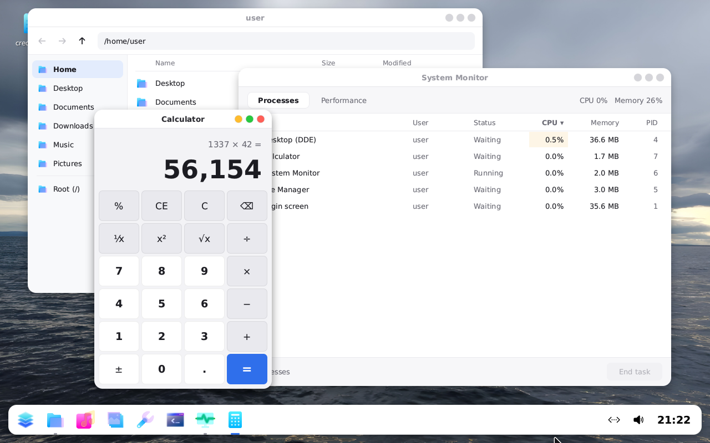

# viralOS

A fully vibecoded operating system, made from scratch in C: its own kernel (**viralKernel**), its own
libraries, and a full desktop (**DDE**, the Divine Desktop Environment) with its own apps. It boots on
real PCs (BIOS and UEFI) and in QEMU.



**Get the ISO:** every push builds one. Open the latest run under
[Actions](../../actions/workflows/build-iso.yml) and download **viralos-iso** under Artifacts.

## Features

### viralKernel
- **Boot:** Limine, BIOS and UEFI, one hybrid ISO; framebuffer console, serial log, a fallback kernel shell
- **CPU:** x86_64, ACPI, local APIC + I/O APIC, APIC timer; SMP (programs run on every core); FPU, SSE and AVX state per thread
- **Memory:** physical page allocator, own page tables with W^X, guarded kernel stacks, kernel heap, shared memory
- **Processes:** ring 3 programs in their own address spaces, ELF loader, shared libraries linked by a dynamic linker in the kernel, 69 system calls, IPC channels and named services, TTYs with Ctrl+C
- **Linux compatibility layer:** runs unmodified static (musl) Linux programs: e2fsprogs, ntfsprogs-plus, dosfstools, exfatprogs and parted's fatresize run as-is
- **Filesystems:** FAT12/16/32, exFAT, ext4 and NTFS; ext4 read-write in the kernel (lwext4, with the journal), read-write NTFS through a user-space server; a VFS with a RAM root, `/dev`, automounting and `/etc/fstab`
- **Storage:** NVMe, SATA (AHCI), USB 3 (xHCI) mass storage with hot-plug
- **Input:** PS/2 and USB keyboards and mice
- **Sound:** Intel HD Audio
- **Network:** lwIP TCP/IP stack, DHCP, DNS, BSD sockets; virtio-net, Intel e1000 and e1000e, Realtek r8169/8125; PCI MSI and MSI-X
- **HTTPS:** TLS 1.2/1.3 (mbedTLS) with certificate checking against the Mozilla root store, an HTTP/1.1 client library, `wget` and `sha256sum`; a kernel random generator (ChaCha20, seeded from RDSEED/RDRAND and timing jitter)

### Userland
- Its own C library, 2D graphics with anti-aliasing and shadows, and a TrueType font renderer
- Its own image decoders: PNG, JPEG (baseline and progressive), WebP (lossy and lossless), GIF, BMP, TIFF
- MP3, OGG Vorbis, FLAC and WAV playback
- The usual Unix layout (`/usr/bin`, `/etc`, `/home`, `/media`, `/tmp`) and freedesktop `.desktop` launchers
- Users and groups (`/etc/passwd`, `/etc/shadow`, PBKDF2-SHA256 password hashes): `sudo`, `su`, `useradd`, `userdel`, `passwd`, `id`
- A shell with line editing, history, Tab completion, redirects and background jobs, and commands like `ls`, `cp`, `ps`, `kill`, `ping`, `netctl` and `wget`

### DDE, the Divine Desktop Environment
- A compositing window manager: shadows, rounded corners, resizing, maximize, full screen
- Login and lock screen, several accounts, per-user settings and wallpapers
- A dock-style panel, a scrollable apps menu, network and volume flyouts, desktop icons with drag and drop, system sounds
- Shutting down closes the apps and unmounts the drives first, and warns when it can't
- **An installer:** language, license, the disk, your account; it sets the disk up to start the way
  the PC does (UEFI: GPT and an EFI System Partition; BIOS: MBR and Limine's boot code): a small FAT32
  boot partition and the system on ext4, mounted as `/` with its permissions and journal
- **Apps:** Files, Terminal, Text Editor, Music, Photos, Disks (partition, format, resize, mount), Settings, Snipping Tool (Print Screen), System Monitor, Calculator

## Installing

Boot the ISO (from a USB stick, a DVD or a virtual machine) and open **Install viralOS** on the
desktop. Installing erases the disk you choose, so trying it in a virtual machine first is a good idea.

## Building

On Linux (or WSL), with `gcc`, `binutils`, `make`, `python3`, `xorriso`, `git` and `curl`:

```sh
make limine/limine-bios.sys limine-protocol/include/limine.h   # downloads the Limine bootloader
scripts/fetch_ports.sh       # once: the ported disk tools' sources and musl (next to this folder)
./build.sh                   # everything -> viralos.iso   (./build.sh --no-ports reuses ports/bin)
make run                     # boot it in QEMU
```

`scripts/tests/` has scripted QEMU runs (`python3 scripts/drive.py` clicks and types through them and
saves screenshots in `build/`).

## Layout

| Folder | What's in it |
|---|---|
| `src/` | the kernel (drivers, filesystems, networking, processes, the Linux layer) |
| `user/` | the C library, the other libraries and every program and app |
| `abi/` | what the kernel and programs share: system calls (`viralos.h`), paths (`paths.h`) |
| `resources/` | the desktop's fonts, icons, cursors, sounds and wallpapers (`/usr/share/dde-res`) |
| `rootfs/` | the rest of the root filesystem: `/etc`, `/home`, the app launchers |
| `ports/` | the read-write NTFS server; the ported tools are built into `ports/bin` |
| `scripts/` | the build and test scripts |

## Credits

viralOS stands on a lot of great free and open-source work:

- **Limine**: the bootloader
- **lwIP**: the TCP/IP stack
- **lwext4**: the ext4 filesystem
- **Mbed TLS**: TLS and the cryptography under it
- **Mozilla**'s list of trusted root certificates (via [curl.se/ca](https://curl.se/ca/cacert.html))
- **The Linux kernel**: the xHCI, USB, AHCI, NVMe, HD Audio, Intel e1000/e1000e, Realtek r8169 and filesystem drivers were ported from or written after its sources
- **minimp3** (lieff), **stb_vorbis** (Sean Barrett), **dr_flac** and **dr_wav** (David Reid): audio decoding
- **stb_image_write** (Sean Barrett): PNG saving
- **e2fsprogs, ntfsprogs-plus, dosfstools, exfatprogs, GNU parted and fatresize**: the disk tools, built from their upstream sources against **musl** libc
- **DejaVu** fonts and the **Terminus** console font
- **Icons8**: the icons ([icons8.com](https://icons8.com))
- **Syn Cole – Feel Good** [NCS Release]: the sample song i used for testing the audio thing

Built with [Claude Code](https://claude.com/claude-code).

## License

viralOS is under the [GNU General Public License, version 2](LICENSE) (parts of it are ported from
Linux, which is GPL v2). The third-party parts keep their own licenses, all compatible with it: lwIP
(BSD), lwext4 in `src/fs/ext4/lwext4` (BSD; `ext4_extent.c` and `ext4_xattr.c` GPL v2 or later), Mbed TLS
in `user/libs/tls/mbedtls` (Apache-2.0 or GPL-2.0-or-later; used under the GPL), the root certificates
(MPL 2.0), the vendored audio and image libraries (public domain / MIT), the fonts (DejaVu, SIL OFL), and the ported
tools, which are GPL and are downloaded and built from their upstream sources.
